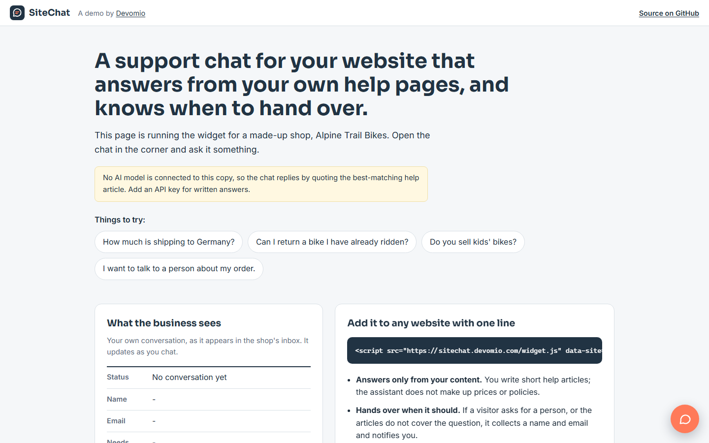

# SiteChat

**Live demo: [sitechat.devomio.com](https://sitechat.devomio.com/)**



An AI support chat for your website that answers from your own help articles, and knows when to
hand over to a person.

Add one line of code to any site. Visitors ask questions in the corner chat; the assistant answers
from the help articles you wrote and nothing else. When someone asks for a person, or asks
something the articles do not cover, it collects their name and email and notifies you with the
full conversation.

Built by [Devomio](https://devomio.com/) as an open example of a production-shaped AI support
widget: small enough to read in an afternoon, with the parts a real deployment needs.

```html
<script src="https://YOUR-SITECHAT-HOST/widget.js" data-site="your-site" async></script>
```

## What it does

- **Answers only from your content.** The assistant sees the help articles that match the question
  and is told to use nothing else, so it does not invent prices, policies or promises.
- **Hands over when it should.** Two tools let the model act: `request_human` flags the
  conversation, `save_contact_details` stores the visitor's name and email. Both are validated on
  the server before anything is saved.
- **Notifies the business.** A new contact request is emailed to the site owner with the transcript.
- **An inbox for staff.** Help articles, conversations and contact requests are managed in an admin
  area, with status filters and search.
- **Several websites from one install.** Each site has its own articles, colour, greeting, allowed
  origins and notification address.
- **Works on any website.** The widget renders in a shadow root, so it cannot clash with the host
  page's CSS. No framework, no build step, about 10 KB.
- **Private by design.** No cookies and no tracking. A conversation is identified by a random id
  kept in the visitor's browser. Conversations are deleted after 30 days.
- **Safe to expose publicly.** Per-visitor and site-wide daily limits, message and conversation
  length limits, and an origin allow-list per site.

## How it works

```
visitor message  ->  rank help articles (BM25)  ->  best articles + recent chat  ->  Claude
Claude           ->  a reply, or a tool call (request_human / save_contact_details)
tool call        ->  validated and saved on the server  ->  result returned to Claude  ->  reply
```

- `chat/services/knowledge.py` ranks a site's articles against the message with BM25 in plain
  Python. A site has tens of articles, so no vector database is needed.
- `chat/services/bot.py` holds the system prompt, the two tool definitions and the tool loop. The
  loop is bounded, tool inputs are validated, and an invalid email is returned to the model as an
  error so it can ask again.
- `chat/static/chat/widget.js` is the embeddable widget.
- `chat/views.py` is the small JSON API the widget calls, with CORS checks per site.

## Run it locally

Requires Python 3.12 or newer.

```bash
git clone https://github.com/aidevmonir-dev/sitechat.git
cd sitechat
python -m venv .venv
.venv/bin/pip install -r requirements.txt        # Windows: .venv\Scripts\pip
cp .env.example .env                             # set DEBUG=1 and your ANTHROPIC_API_KEY
.venv/bin/python manage.py migrate               # also creates the demo shop
.venv/bin/python manage.py createsuperuser       # for the admin area
.venv/bin/python manage.py runserver
```

Open http://127.0.0.1:8000/ for the demo page and http://127.0.0.1:8000/admin/ for the inbox.

Without an `ANTHROPIC_API_KEY` the widget still works: it replies by quoting the best-matching
article and still collects contact details. That mode is useful for testing your articles.

### With Docker

```bash
cp .env.example .env      # set SECRET_KEY, ANTHROPIC_API_KEY, ALLOWED_HOSTS=localhost
docker compose up --build
```

## Put it on your own website

1. In the admin, add a **Site**: name, greeting, colour, the address that should receive contact
   requests, and the origins allowed to use the widget (for example `https://www.example.com`).
2. Add **help articles** to the site. Short, factual articles work best: one topic each.
3. Paste the script tag into your website, with `data-site` set to the site's slug.

Optional attributes: `data-open="true"` opens the chat on page load, `data-position="left"` moves
it to the left corner. From your own JavaScript you can call `SiteChat.open()`, `SiteChat.close()`
and `SiteChat.reset()`.

## Configuration

All settings come from environment variables or a `.env` file. See [.env.example](.env.example).

| Variable | Default | Purpose |
|---|---|---|
| `ANTHROPIC_API_KEY` | none | Claude API key. Empty means article quotes only. |
| `ANTHROPIC_MODEL` | `claude-opus-5-5` | Any current Claude model. `claude-haiku-5-5` costs far less. |
| `EMAIL_HOST` and related | none | SMTP for notifications. Empty prints emails to the log. |
| `MESSAGES_PER_IP_PER_DAY` | `60` | Daily message limit per visitor. |
| `MESSAGES_PER_DAY_TOTAL` | `800` | Daily message limit for the whole install. |
| `RETENTION_DAYS` | `30` | How long conversations are kept. |

## Tests

```bash
DEBUG=1 python manage.py test
```

The tests cover article ranking, the tool loop (contact capture, invalid email, handover, a bounded
loop), the no-key fallback, CORS, rate limits and data expiry. The Claude API is replaced by a
scripted fake client, so they run offline and cost nothing.

## Data handling

- No cookies. The widget keeps only a random conversation id in the browser's local storage.
- Rate-limit counters store a hash of the IP address, not the address.
- Conversations are deleted after `RETENTION_DAYS`. Run `python manage.py purge_old` from cron.
- Visitor messages and the matching articles are sent to the Claude API to write the reply.
- The widget tells visitors they are talking to an AI assistant.

## Limits of this demo

- Keyword ranking matches words, not meaning. A question with none of an article's words can miss.
- The assistant cannot look up orders or accounts. That needs a tool connected to your shop system,
  which is the usual first extension.
- Staff reply by email, not inside the chat.

## Need this for your business?

Devomio builds production versions: your content and branding, live handover to your team,
connections to your shop, booking or CRM system, and hosting in the EU. See
[devomio.com](https://devomio.com/) or write to hello@devomio.com.

## Licence

MIT. See [LICENSE](LICENSE).
